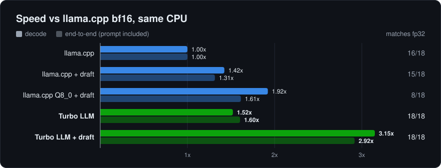

<p align="center">
  
</p>

<p align="center">
  <a href="LICENSE"></a>
  <a href="https://github.com/ViezeVingertjes/turbo-llm/releases/latest"></a>
  
  
  <a href="https://huggingface.co/ViezeVingertjes/Llama-3.2-1B-Instruct-EAGLE3"></a>
</p>

<p align="center">
  <a href="#quick-start">Quick start</a> ·
  <a href="#results">Results</a> ·
  <a href="#how-it-works">How it works</a> ·
  <a href="#using-it-as-a-library">Library</a> ·
  <a href="#limits">Limits</a>
</p>

Turbo LLM runs Llama 3.2 1B Instruct on a CPU with output that is token-for-token identical to the reference: the
official bf16 weights evaluated in fp32 by Hugging Face transformers, with greedy decoding. Nothing is quantized
away. It is one C file with no dependencies.

- **Exact.** The same tokens as the fp32 reference on every test prompt, in every mode, on Intel and AMD CPUs.
  Same weights is not the same output: llama.cpp in bf16 differs on 2 of 18 test prompts.
- **Fast on a CPU.** About 3x llama.cpp bf16, and 2.2x when both use the same draft head, on the same CPU. Decoding is
  limited by memory bandwidth, and Turbo LLM reads about a third of the memory per token that a bf16 runner does.
- **Small.** One C file, a 2.1 GB model file, about 2.2 GB of RAM. Also usable as a C library with KV cache reuse.

Built with Llama.

## Quick start

```sh
make
# the model file, 2.1 GB
url=https://github.com/ViezeVingertjes/turbo-llm/releases/latest/download
curl -LO $url/llama-3.2-1b-instruct-eagle3.tlm
./tlm llama-3.2-1b-instruct-eagle3.tlm "Explain how a CPU cache works."
```

Usage: `tlm model.tlm "prompt" [max_new_tokens=256] [max_draft=3]`. The prompt is wrapped in the Llama 3.2 chat
template as a single user turn, with today's date like the official template. `max_draft=0` turns drafting off.
`TLM_THREADS=n` sets the thread count.

Requirements: Linux on x86-64 with AVX2, FMA and F16C (Intel Haswell or AMD Zen and later), gcc or clang, and
about 2.3 GB of free memory.

## Results

<p align="center">
  
</p>

All numbers here are independent of the hardware, except the speed ratios, which were measured on one machine
with both runners given the same prompts as identical token ids.

Exactness: token-identical to the fp32 reference on every test prompt, in every mode (draft head, prompt lookup,
no drafting), on Intel and AMD CPUs with different compilers. Details below.

Tokens per forward pass with the draft head, Spec-Bench (pinned commit `fd2c1cd`, all 480 questions, first turn
only, up to 1,024 new tokens): 2.64 overall; math 3.16, MT-Bench 2.76, RAG 2.57, question answering 2.48,
summarization 2.39, translation 2.24. With prompt lookup instead of the head: 1.25 (dev subset, 18 questions).

Memory read per generated token, the quantity that sets the speed on a bandwidth-bound CPU:

| Runner | Read per forward pass | Tokens per pass | Read per token |
|---|---|---|---|
| any bf16 runner | 2.47 GB | 1 | 2.47 GB |
| Turbo LLM, prompt lookup | 1.63 GB | 1.25 | 1.30 GB |
| Turbo LLM, EAGLE-3 draft head | 1.63 GB + up to 0.22 GB of draft head | 2.64 | 0.62-0.70 GB |

Speed relative to llama.cpp: same machine, Spec-Bench dev subset (18 questions, up to 1,024 new tokens), both given
the same prompts as token ids, llama.cpp release b12470 at its best thread count and default settings (Turbo LLM's
current version was measured a day later, so its prompts differ from llama.cpp's only in the date token of the
system header):

| Compared with | Decode speed | End-to-end | llama.cpp output identical to the exact one |
|---|---|---|---|
| llama.cpp, bf16 | 3.15x | 2.92x | 16 of 18 |
| llama.cpp, bf16 + the same EAGLE-3 draft head | 2.21x | 2.22x | 15 of 18 |

Without any drafting, Turbo LLM decodes 1.52x faster than llama.cpp in bf16 (1.60x end-to-end). llama.cpp's bf16 output also shows why
"same weights" is not "same output": it differs from the exact result on 2 of 18 prompts, and on a third once
speculative decoding batches the computation.

Peak memory is 2.14 GB with the draft head, plus 64 KB per token of context.

## How it works

None of these changes a single output token. Click a part to read how it works.

<details>
<summary><b>Lossless 12-bit weights</b>: every bf16 weight stored bit for bit in 12 bits, decoded with one table lookup</summary>

A bf16 weight is a sign bit, 8 exponent bits and 7 mantissa bits. Trained weights use only a handful of exponents,
so the high byte (sign and the top 7 exponent bits) is stored as a 4-bit code into a 16-entry table per matrix,
and the low byte is stored as is. Code 15 is an escape for the rare high bytes outside the table (0.03% of the
weights); those decode to zero and their true values are added from a sparse exception list.

Every weight comes back bit for bit. The weights take 1.86 GB instead of 2.47 GB, and decoding is one `vpshufb`
table lookup per 32 weights plus a few unpacks. The converter permutes the columns inside each 64-weight block so
that the unpacks never have to cross 128-bit lanes, and stores the layer matrices in tiles of 8 rows by 512
columns, so a pass over a few tokens works on a small piece of the activations at a time. The order in which each
token's sums are formed does not change, so the results are bitwise the same as without tiling.

</details>

<details>
<summary><b>Exact output layer, mostly skipped</b>: an int8 screen with a proven error bound, then only a few rows computed exactly</summary>

The output layer has 128,256 rows of 2,048 weights, 21% of the model. A greedy decoder only needs its largest
entry. The file also holds an int5 copy of the layer (sign and magnitude, an fp16 scale per 64 weights, 173 MB),
and each token's features are rounded to int8 (one scale per 64 values). Their product is then exact integer
arithmetic per block (`vpmaddubsw`, `vpmaddwd`), with one floating-point multiply-add per block for the scales.

The screen value differs from the exact logit by `(w - w5) . x + w5 . (x - x8)` plus rounding, so by
Cauchy-Schwarz it is within `||w - w5|| ||x|| + ||w5|| ||x - x8||` of it, plus small explicit terms for fp32
rounding and underflow. The file stores both row norms; the feature norms are computed per token in double
precision and rounded up.

So each token first screens all rows, keeps only those whose upper bound reaches the best lower bound, and
recomputes those few rows exactly. The winner is the same row the full exact computation would pick, including
ties (the first maximum in row order wins, as in a serial argmax). A self-test checks this against a brute-force
exact argmax over all 128,256 rows, including feature vectors built to make the int8 rounding as bad as possible.

</details>

<details>
<summary><b>Speculative decoding that cannot change the output</b>: batched, tree and one-at-a-time results are bitwise identical</summary>

Each forward pass checks a small tree of guessed tokens at once and keeps the longest prefix the model agrees
with, plus the model's own next token. That only preserves the output if checking a token inside a batch gives
bitwise the same logits as computing it alone, so the decode kernel sums in the same order whatever the batch size, and
a tree node attends to the context and then to its ancestors in sequence order. Batched, tree and one-at-a-time
results are bitwise identical; a bad guess costs time, never correctness.

</details>

<details>
<summary><b>Prompt processing</b>: 64-token chunks through a kernel built for many tokens at once</summary>

Prompts run in chunks of 64 tokens. Each tile of 8 rows by 512 columns is decoded once per chunk, and a kernel
whose vector lanes are 8 tokens (4 rows by 24 tokens per step, weights broadcast) needs 7 memory loads per 12
multiply-adds. The decode kernel's summation order would allow only 2 rows by 3 tokens in AVX2's 16 registers,
13% slower. This makes prompt processing about 1.28x faster than running the prompt through the decode kernel
in 8-token batches.

Each prompt token's sums depend only on the columns, never on which chunk the token is in, so splitting a prompt
differently gives bitwise the same result. The prompt kernel adds in a different order from the decode kernel, so
the two differ by fp32 rounding, at the same distance from the fp32 reference; the output tokens are the same.

</details>

<details>
<summary><b>The draft head</b>: an EAGLE-3 head trained on the model's own answers</summary>

The guesses come from an EAGLE-3 draft head: one small transformer layer that reads hidden states of the main
model (the inputs of layers 2, 8 and 13), the embedding of the last token, and predicts the next token over the
32,768 most frequent tokens. All its weights are int5 in the file.

It was trained on Llama's own greedy answers to 400,000 prompts from SmolTalk (none from Spec-Bench), so it learns
to predict this exact model rather than human text, with EAGLE-3's training-time test over 3 steps. Training took
about 1.5 hours on four H100s.

At run time the head drafts up to 3 tokens. Every draft step also yields its runner-up, and the 3 most probable
candidates with a joint probability of at least 0.1 form the tree (EAGLE-2 style). Without a draft head in the
file, Turbo LLM drafts by prompt lookup: it continues the latest earlier occurrence of the last 1 to 3 tokens.

The head is also published on Hugging Face as
[Llama-3.2-1B-Instruct-EAGLE3](https://huggingface.co/ViezeVingertjes/Llama-3.2-1B-Instruct-EAGLE3), in the
SpecForge checkpoint format and as a GGUF for llama.cpp (`--spec-type draft-eagle3`).

</details>

<details>
<summary><b>Memory and threads</b>: O_DIRECT loading, 2 MB pages, one pinned thread per core</summary>

The model file is read with `O_DIRECT` into memory backed by 2 MB pages, so there is no second copy in the page
cache and no TLB misses every 4 KB. Activations and the KV cache are fp32. The KV cache is stored per KV head and
contiguous over positions; each attention task handles one KV head and the 4 query heads that share it, so every
key and value is read once for all four.

A spinning thread pool runs one thread per physical core, each pinned to its own core. That is the fastest setting
unless the CPU is power-limited: a thin laptop under sustained load can decode faster on about three quarters of
its cores, so set `TLM_THREADS` there. There is deliberately no automatic tuning. A short benchmark at startup sees
a cool CPU in its boost phase and picks too many threads, and tuning during use cannot settle on stateless hosts
such as serverless functions.

</details>

## How exactness was checked

On 10 varied prompts (code, arithmetic, translation, lists, JSON, repetition), 128 new tokens each, Turbo LLM was
compared with Hugging Face transformers running the bf16 weights in fp32:

- the prompt token ids, which checks the tokenizer;
- every generated token, with the draft head, with prompt lookup and with drafting off;
- the full 128,256-entry logit vector after the prompt.

All prompts were token-identical in every mode. The largest logit difference is 6e-5, which is fp32 rounding,
against top-1 margins of at least 0.29. The token ids were checked again on a second machine with a CPU from the
other vendor and another compiler version, with the same result.

"Exact" means the same greedy tokens as the fp32 reference. The logits themselves differ by float rounding, so a
prompt whose two best logits are within about 1e-4 of each other could in principle pick the other token. No such
case came up.

## Using it as a library

`src/libtlm.c` builds the same code as a library, for a chat front end or any language with a C FFI; the API is in
`src/tlm.h`. `make lib` gives `libtlm.a`. There is one model per process, and it is used from the thread that
loaded it.

A conversation is a growing array of token ids, so you can use any chat template or role (tool results, for
example). `tlm_generate` appends the reply to that array. Pass it the length the previous call returned, minus
one, and it only runs the tokens you added since then through the model, instead of the whole conversation again.
The output is the same as without that shortcut.

```c
#include <stdio.h>
#include <stdlib.h>
#include "tlm.h"

// called for every new token except special ones
static void print(int token) {
  const char *bytes;
  int len = tlm_token(token, &bytes);
  fwrite(bytes, 1, len, stdout), fflush(stdout);
}

// a user message, then the assistant header
static int user_turn(int *ctx, int n, const char *text) {
  const char *parts[2][2] = {{"user", text}, {"assistant", 0}};
  for (int i = 0; i < 2; i++) {
    ctx[n++] = TLM_HDR_START;
    n += tlm_encode(parts[i][0], ctx + n, 8);
    ctx[n++] = TLM_HDR_END;
    n += tlm_encode("\n\n", ctx + n, 8);
    if (parts[i][1]) n += tlm_encode(parts[i][1], ctx + n, 4096), ctx[n++] = TLM_EOT;
  }
  return n;
}

// the -1 error returns are not checked, to keep the example short
int main(void) {
  if (tlm_load("llama-3.2-1b-instruct-eagle3.tlm")) return 1;
  int *ctx = malloc(tlm_context() * sizeof *ctx), passes;
  int n = tlm_chat_prompt("Name three prime numbers.", ctx);
  // afterwards the cache holds ctx[0..n - 1)
  n = tlm_generate(ctx, n, 0, 256, 3, print, &passes);
  // close a reply that was cut off by the length limit
  if (ctx[n - 1] != TLM_EOT) ctx[n++] = TLM_EOT;
  int m = user_turn(ctx, n, "Now multiply them.");
  printf("\n--\n");
  // only the new tokens are run through the model
  m = tlm_generate(ctx, m, n - 1, 256, 3, print, &passes);
  printf("\n");
  free(ctx);
}
```

```sh
make lib
cc -O3 -march=native -pthread -Isrc example.c libtlm.a -lm -o example && ./example
```

## Limits

- Llama 3.2 1B Instruct only; the dimensions are compiled in.
- Greedy decoding only, 8,192 tokens of context (prompts up to 8,176 tokens). The command line takes one user
  message; the library takes any token sequence, so multi-turn chats and other templates work there.
- The tokenizer reimplements the Llama 3 pre-tokenizer and treats every non-ASCII byte as a letter, so unusual
  Unicode punctuation may be split differently from Hugging Face. It matched on every test prompt.
- AVX2 only. Machines with AVX-512 run the AVX2 code.

## License

The code is MIT licensed (`LICENSE`). The model file in the releases is a re-encoding of Llama 3.2 1B Instruct
plus a draft head trained on its outputs, distributed under the Llama 3.2 Community License (`LICENSE-LLAMA`) and
its Acceptable Use Policy (`USE_POLICY-LLAMA.md`). See `NOTICE`.

Llama 3.2 is licensed under the Llama 3.2 Community License, Copyright © Meta Platforms, Inc. All Rights Reserved.
